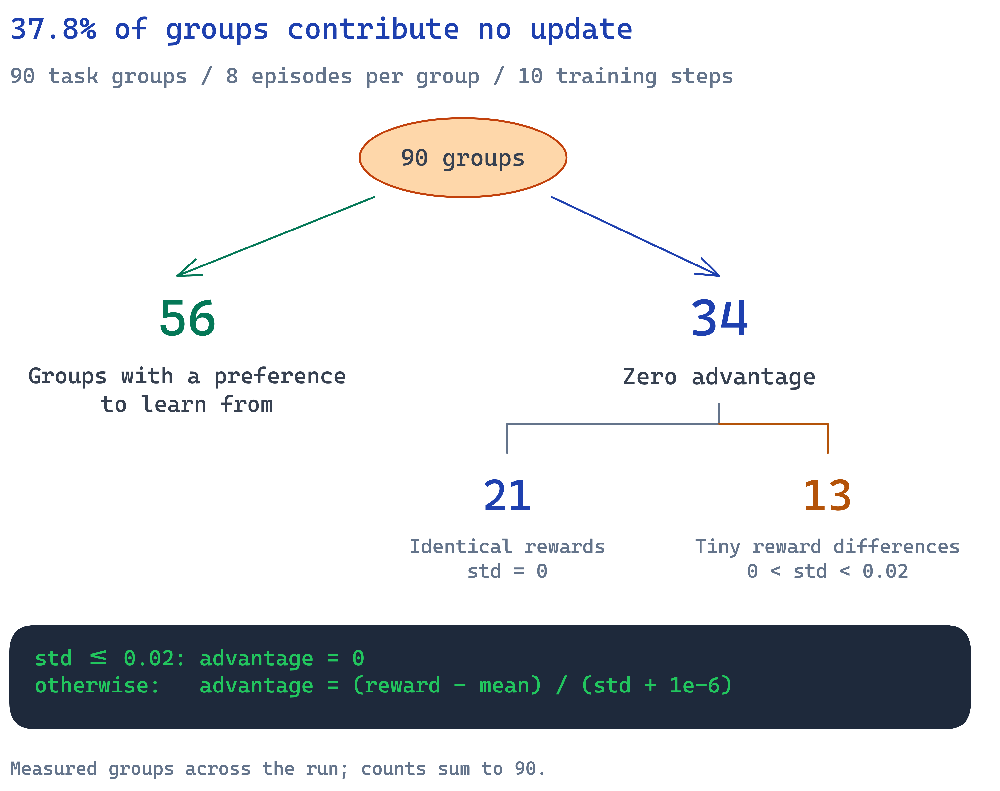
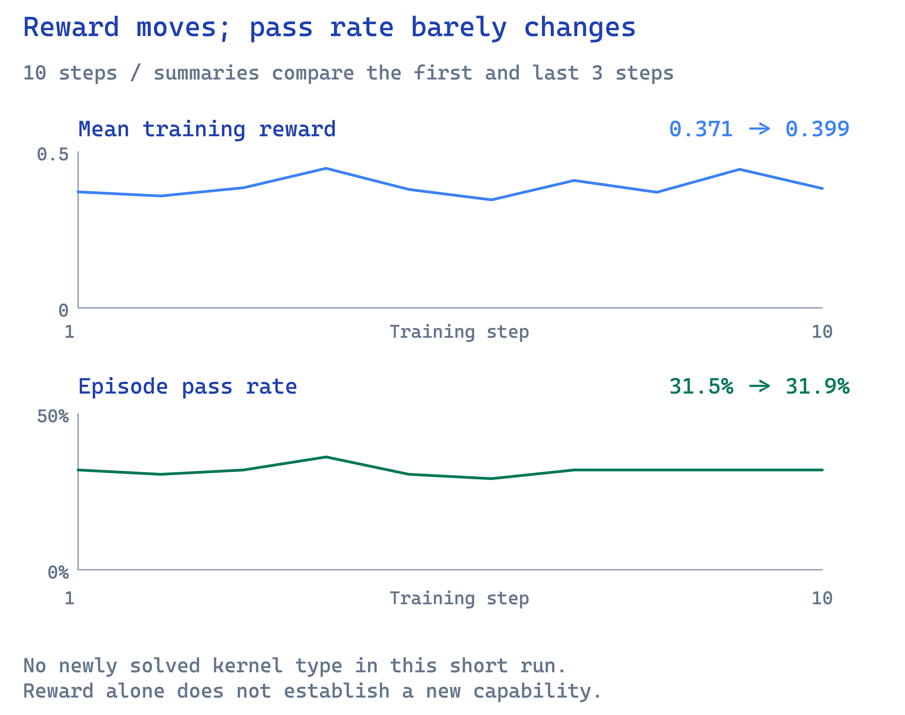
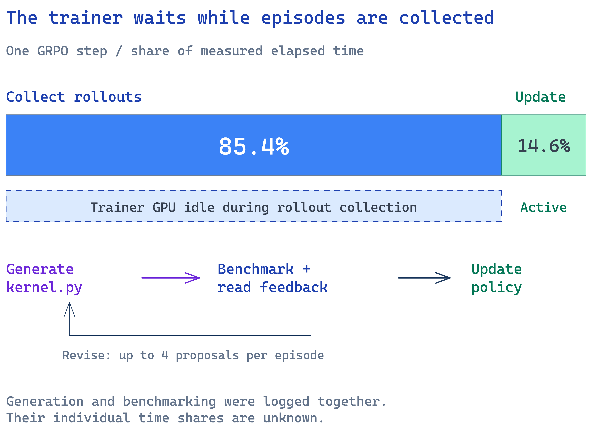

The most promising kernel in my GRPO experiment was an RMSNorm implementation that benchmarked at roughly 2.9× faster than eager PyTorch. When I measured it against the starter kernel, the improvement disappeared. When I checked its numerical behavior, it returned zeros on inputs the starter handled correctly. The benchmark had rewarded it for reproducing a bug in the reference.

I built this project to see whether a small coding model could learn to write faster Triton kernels by proposing code, running it on a GPU, and learning from the results. Kernels seemed like a good fit for reinforcement learning with verifiable rewards: check the output, measure the runtime, assign a score. **What I learned was that a GPU benchmark only becomes a useful reward after you establish that it measures correctness honestly and can distinguish improvement from noise.**

The useful results came from auditing that chain. I fixed the verifiers, improved the feedback, inspected the advantages, and eventually switched to supervised fine-tuning. That taught the model to produce more correct kernels. Learning to make them faster remains unfinished.

The findings I would carry into another run:

- A passing kernel can expose a broken reference. Test the verifier itself before trusting its rewards.
- GRPO needs meaningful differences within each group; a noise threshold keeps tiny timing differences from driving updates.
- Partial credit gives the model a learning signal before a full pass, but that signal does not guarantee new solutions.
- Supervised fine-tuning improved correctness and transfer; speed barely moved.

## The setup

The model received a PyTorch reference and a starter kernel, then wrote a complete `kernel.py`. The benchmark ran that file on a real GPU and returned results for the next revision.

| Piece | Configuration |
|---|---|
| Task | Nine kernel types, including softmax, layernorm, RMSNorm, and matmul |
| Policy | Qwen2.5-Coder-7B-Instruct, with LoRA rank 64 |
| Verifier | AutoKernel: five correctness stages, then timing against eager PyTorch |
| Reward | Partial credit for correctness progress; a full-pass floor of 0.5 plus a clipped log-speedup bonus |
| Training episode | Propose → benchmark → read feedback → revise, with four turns |
| GRPO | Eight episodes per task; group-normalized advantages with a 0.02 noise threshold; one on-policy update; no KL penalty |
| Compute | Modal: one trainer GPU, one vLLM policy GPU, up to eight benchmark GPUs |

I expected the starter code to give the model a foothold: begin with a working implementation, explore changes, and reinforce the ones that improved runtime. The experiment depended on two things: whether the benchmark judged correctness reliably, and whether the sampled episodes gave the optimizer useful choices.

## 1. The verifier can reward the wrong answer

The benchmark checked more than whether the code compiled. It tested shapes, numerical stability, determinism, and edge cases. That made the reward look convincing. RMSNorm showed why even a detailed test suite needs an independent check of its reference.

The apparent 2.9× win came from fusion that was already in the starter. Eager PyTorch performed the operation through six kernel launches; the starter fused it. Independent remeasurement put the model's edit at 1.004× relative to the starter at the primary shape, and a geometric mean of 0.999× across 32 configurations. There was no meaningful speed improvement attributable to the edit.

The substantive changes were two casts from float32 to float16:

```diff
- x = tl.load(X_ptr + row * stride_xm + offs * stride_xn, mask=mask, other=0.0).to(tl.float32)
+ x = tl.load(X_ptr + row * stride_xm + offs * stride_xn, mask=mask, other=0.0).to(tl.float16)
- w = tl.load(W_ptr + offs, mask=mask, other=0.0).to(tl.float32)
+ w = tl.load(W_ptr + offs, mask=mask, other=0.0).to(tl.float16)
```

Those casts made the RMS calculation overflow. At a row width of 4096, rows with RMS above roughly 4 could become all zeros. The benchmark reference also overflowed on its large-magnitude test, so the broken implementation agreed with it and passed. The starter accumulated in float32, produced the correct result, and failed that check.

This is a particularly uncomfortable failure mode for RL: improving numerical accuracy could lower the reward. The model found a change that satisfied the verifier, exactly as the training objective requested.

For independent evaluation, I used higher-precision references, adversarial magnitudes, and fresh inputs. The RMSNorm candidate failed those checks. Its measured advantage over eager PyTorch was real, but the useful optimization was inherited from the starter, and the model's change damaged correctness.

I learned to ask two separate questions about every apparent win: does the output remain correct against an independent reference, and how much of the speedup comes from the model's edit? Comparing only with eager PyTorch could not answer the second question.

Before another training run, I would give the verifier deliberately wrong kernels, an accurate implementation, and the reference itself. I would want to understand every disagreement before using the verdict as a reward.

## 2. Feedback has to explain what failed

The model received structured benchmark results and the failing check's lines, with crash details when relevant. I wanted each observation to point toward a concrete repair: a compile error, an incorrect shape, a numerical mismatch, or a launch failure.

That detail matters in a multi-turn task. The model cannot inspect the GPU directly. Its entire view of the execution comes through the message returned by the benchmark. If that message omits the failing case, the next revision starts with incomplete evidence.

Even useful feedback cannot substitute for the skill to act on it. On the held-out validation set, the base model had a per-turn compile-error rate of 8.1%, and its repeat-same-error rate was 0.338. More turns gave it more opportunities, but recurring failures showed that some of those opportunities were being spent on unsuccessful repairs.

Each extra turn costs generation and a GPU benchmark. Before increasing the turn budget, I would read complete conversations and identify what stopped the model from making progress. That inspection also tells me what repair examples to collect for supervised training.

## 3. GRPO needs differences it can trust

GRPO compares episodes sampled for the same task. In my implementation, the advantage was approximately:

```text
if group standard deviation <= 0.02:
    advantage = 0
else:
    advantage = (episode reward − group mean) / group standard deviation
```

If every episode receives the same reward, the group offers no preference to learn from. A group with tiny differences is also suspect: dividing by a tiny standard deviation can amplify measurement noise into a substantial update weight.

I used a threshold of 0.02 to suppress that small-variation regime. Across the ten-step run, an average of **37.8% of groups had zero advantage**, including both exact ties and groups suppressed by the threshold.


*Across 90 groups, 56 contribute an update; 21 tie exactly and 13 fall below the noise threshold. [Editable diagram](figures/grpo_group_signal.excalidraw).*

An offline recomputation showed why the threshold mattered. Without it, groups with nonzero reward standard deviation below 0.02 would have accounted for 17.4% of total absolute advantage. With the threshold used in training, their contribution was zero.

This is a comparison of update weights on the same rollouts, not a separate training experiment. It measures advantage mass rather than the exact parameter gradient, and the threshold does not prove that every small difference is noise. It makes explicit how much variation I am willing to trust.

The remaining challenge was whether the groups with a signal contained choices that would teach the model to complete harder kernels. A nonzero advantage tells me the optimizer can update. It does not tell me that the preference is useful enough to improve the task.

## 4. Partial credit gave signal without clear skill gains

The reward gave partial credit for correctness progress through the smoke test, shape sweep, and numerical-stability checks. A full pass always scored above partial progress:

```text
Any passing turn:
    reward = 0.5 + clip(log2(best passing speedup), 0, 3)

No passing turn:
    reward = 0.3 × best correctness progress across turns
```

This ordering rewards a correct kernel even when it is slower than PyTorch. It also distinguishes an episode that makes progress through the checks from one that fails immediately. Speed matters once the kernel passes.

Across the first three and last three steps, mean training reward went from 0.371 to 0.399. Episode pass rate stayed nearly flat, from 31.5% to 31.9%.


*The ten-step run shows fluctuations in reward and little movement in pass rate. A higher reward average is insufficient evidence of a new capability. [Editable diagram](figures/grpo_training.excalidraw).*

The run produced passing episodes for cross-entropy, reduction, RMSNorm, and softmax under the training verifier, the same kernel types the base model could solve. RMSNorm's apparent success also needed the numerical audit described above. I could not count every benchmark pass as a correct solution.

Ten steps are too few to establish what a longer run might achieve. Within this budget, partial correctness gave the optimizer more information, but I saw no expansion to newly solved kernel types. Completing the difficult kernels remained the bottleneck.

That led me to a different question: could I first teach the model to write and repair valid Triton reliably enough for RL to have useful candidates to compare?

## 5. Supervised fine-tuning improved correctness; speed stayed flat

I assembled 3,022 training examples and 60 development examples from Dr. Kernel, kernels generated in this project, and KernelBook. The pipeline filtered and GPU-verified the examples, then removed detected KernelBench Level 1 overlap. Repair examples made up 15% of training: a broken kernel, its feedback, and a corrected response.

Verification was consequential. Only 69 of 1,029 selected KernelBook rows passed the checks; many generated implementations hard-coded shapes and failed on a second shape. Code that looks like a useful kernel example still needs to satisfy the task you intend to teach.

Most training examples came from Dr. Kernel, whose trajectories are distilled from GPT-5. The source provenance and terms are recorded in the mix report; the assembled datasets are not published.

I trained the LoRA adapter for two epochs, or 378 steps, then compared it with the base model using evaluation harnesses with independent correctness checks.

| Metric | Base | After SFT |
|---|---|---|
| Validation pass@1, 62 problems | 0.383 | 0.508 |
| Triton compile errors per turn | 8.1% | 1.9% |
| KernelBench L1: correct with a Triton launch | 0/100 | 20/100 |
| …and faster than eager PyTorch | 0/100 | 10/100 |
| Geometric-mean speedup vs starter, solved validation episodes | 0.950× | 1.003× |

*Validation pass@1 refers to one sampled episode with up to four proposals, not one code response. KernelBench uses one episode with up to three proposals and additionally checks for a Triton launch. Source: `results/v3/phase3.md`.*

The correctness gain was the clearest positive result in the project. Compile errors became much less frequent, and the model transferred to KernelBench: seven of its solutions were among 59 problems whose operations were classified as unseen in SFT.

Speed remained close to the starter. Only two of 126 solved SFT validation episodes beat it by more than 5%. Even with a speed component in the reward, most available group variation would still come from passing versus failing.

I did not resume GRPO after SFT because of the budget. These results support SFT as a better starting point for this model; they do not establish that SFT followed by RL would improve speed. That experiment is still open.

## 6. The expensive part was waiting for measurements

Collecting rollouts took 85.4% of step time; the policy update took 14.6%. The trainer GPU was idle during rollout collection. This run did not log generation and benchmarking separately, so I can report their combined cost in elapsed time.


*Most step time goes into collecting episodes. The trainer only updates after generation and benchmarking finish. [Editable diagram](figures/grpo_step_time.excalidraw).*

This changes where I would spend engineering effort. Faster optimizer code would address a small fraction of elapsed time. Avoiding uninformative rollouts and overlapping collection with training could matter much more.

The GRPO run cost an estimated $11.15 based on wall time. That is an estimate, not a bill. A realistic cost model also needs container startup, extra checks, hung jobs, and reruns; the rollout and update timers alone do not capture the whole experiment.

A realistic reproduction budget needs the verifier debugging and remeasurement work as well as the training loop. In this project, those measurements were what made the training results interpretable.

## What I would try next

- **Build a curriculum from measured pass rates.** Sample tasks where the SFT model sometimes succeeds, so groups can compare successful and unsuccessful attempts.
- **Compare mean-centered advantages with noise-thresholded normalization.** Remeasure promising candidates independently before treating a small runtime difference as progress.
- **Separate correctness from speed in evaluation.** Track passes, speed against the starter, and speed against `torch.compile` across shapes, so inherited fusion gains stay visible.
- **Improve repair data for recurring failures.** Target the compile errors and repeated numerical mistakes observed in actual conversations.
- **Overlap rollouts with training.** Keep the trainer working while benchmark workers collect the next batch, once the reward is trustworthy enough to justify more compute.

I would make the next run earn its compute budget by showing that its groups contain meaningful choices. This project gave me a model that writes more correct Triton and a much better understanding of what my benchmark can claim. The remaining goal is to turn reliable correctness into reliable optimization.

## Code and data

The code, reports, and measured results are in the [project repository](https://github.com/Ramshankar07/Kernel-Writer-RL-v2). The supporting artifacts are `results/numbers.json` for the agent evaluations and GRPO run, `results/extra_numbers.json` for the advantage and timing analyses, and `results/v3/` for verifier fixes, independent remeasurement, and SFT evaluation.

The SFT datasets are not published. The ingestion, verification, decontamination, and assembly scripts are included so the data pipeline can be inspected and rebuilt.
